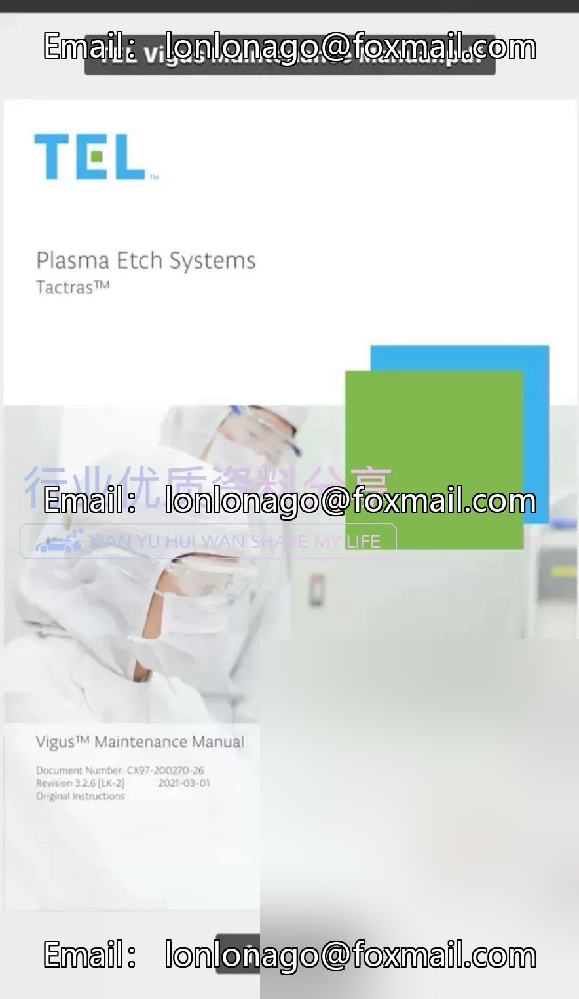
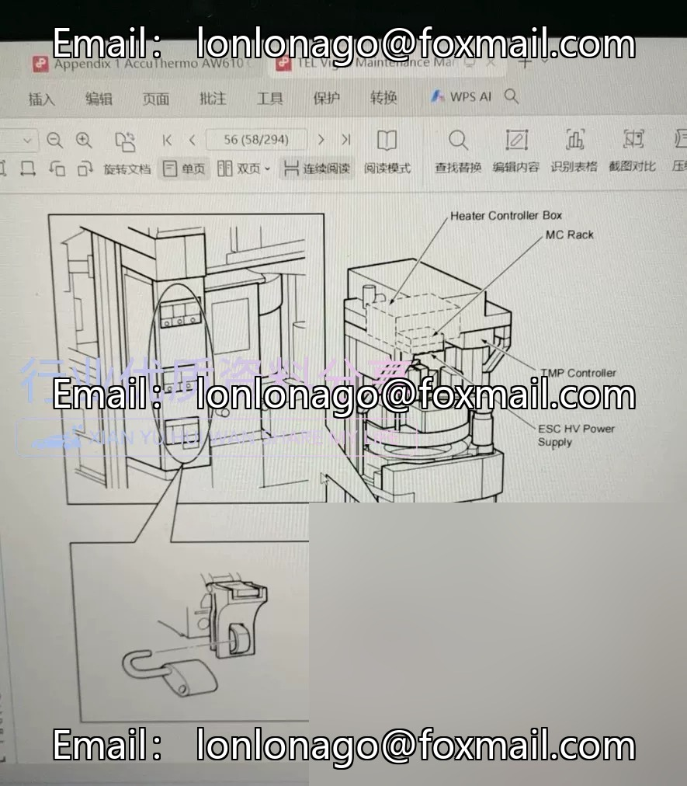
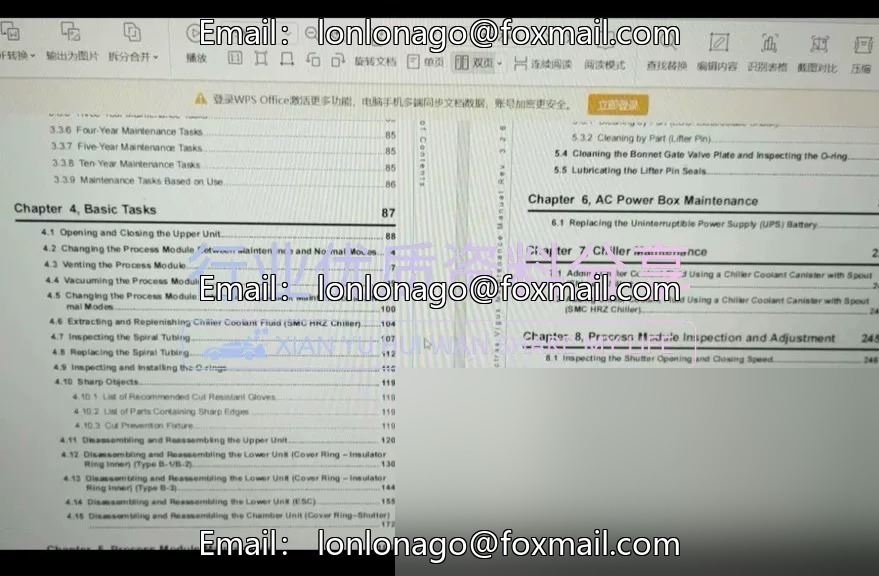
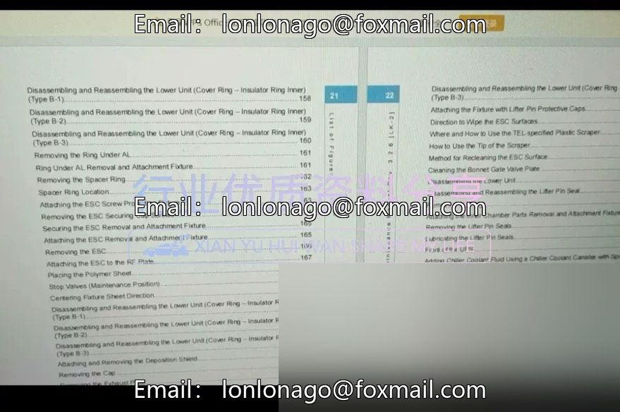
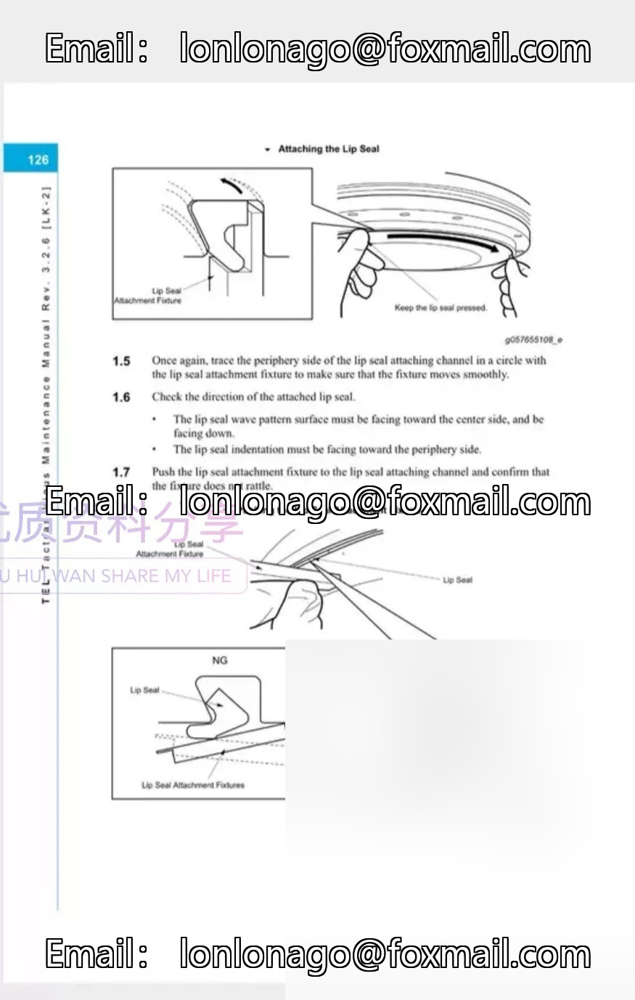
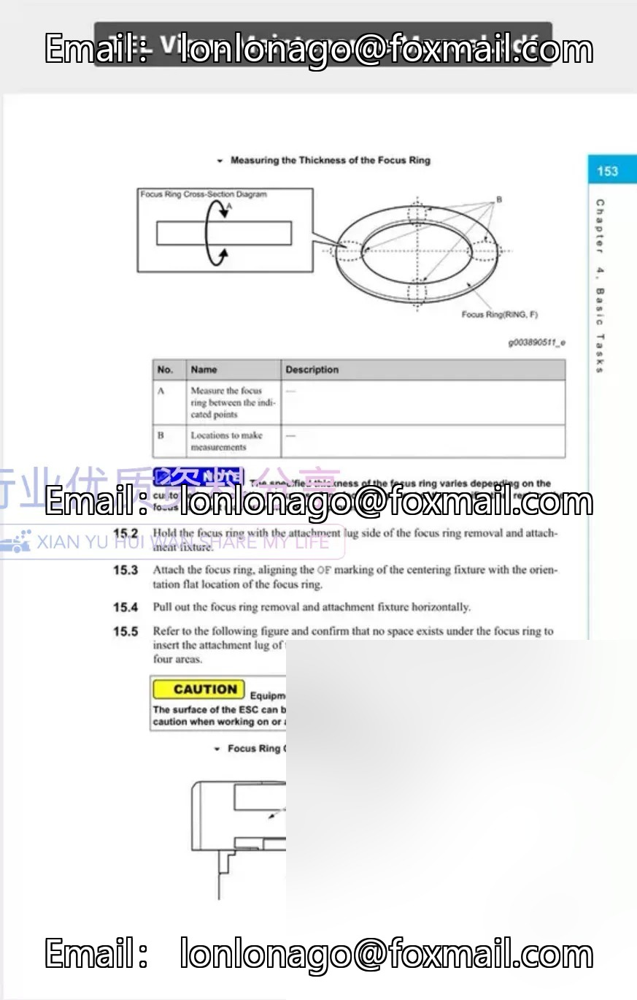
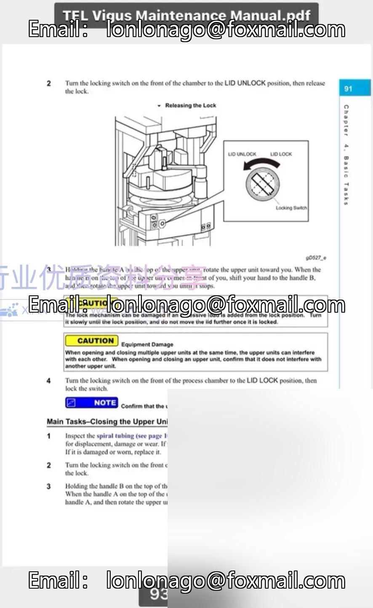
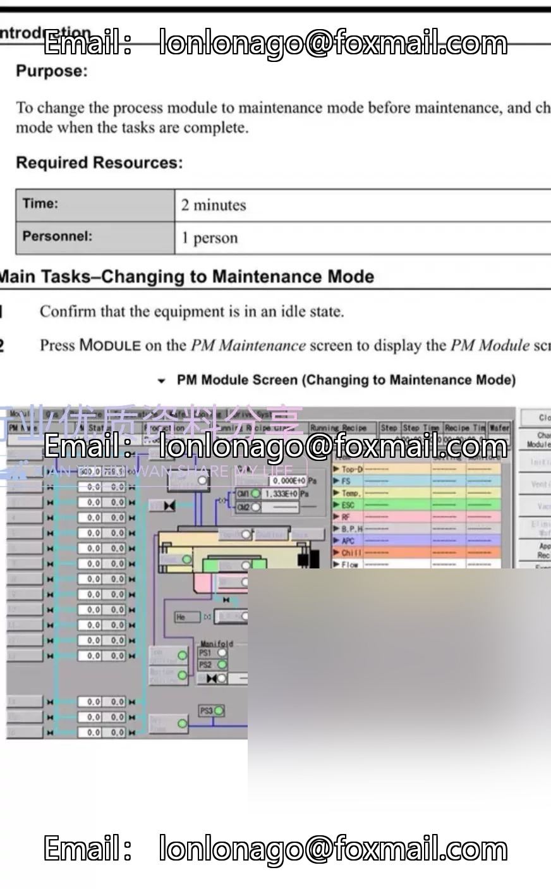
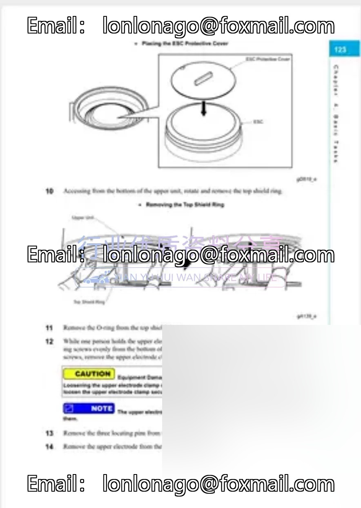

# TEL+Dongdian Electronics+ETCH+Plasma Etching+vigus

## Body

# TEL+Dongdi Electronic+ETCH+Plasma Etching+vigus+series machine installation and maintenance manual

Semiconductor equipment engineer troubleshooting all skills. Disassembly and reassembly of components, installation methods for parts, and various sensor+calibration methods for water, electricity, and gas are all introduced!

Capture and send the electronic original directly! The following images include screenshots of the file portion. Please confirm before placing the order! Due to the replicable nature of electronic documentation Therefore, are allowed after purchase! Thanks for understanding!

For personal learning and reference use only.

Covering TEL, plasma etch systems and vigus series machine maintenance manuals, it includes troubleshooting, component disassembly, installation methods and calibration methods, along with relevant file screenshots and document features.

<!-- AI_ENRICHED -->

## Images

## Payment

Here is a pay link on Stripe ( https://buy.stripe.com/3cs8yP7sY87d0vu9AB ). Please contact me lonlonago@foxmail.com after funding $89, and I will send you a complete data files , thank you!

